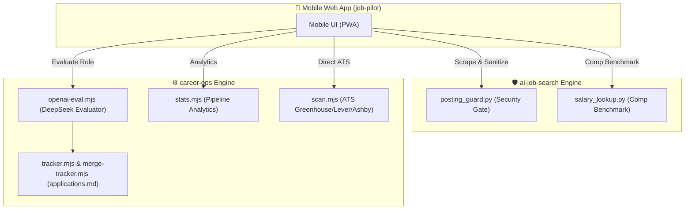

# 🚀 Job Pilot — Dual-Engine AI Job Search & Application Assistant

[](https://nodejs.org)
[](https://python.org)
[](https://deepseek.com)
[](LICENSE)

An open-source, mobile-first AI job search assistant that unifies the capabilities of **`career-ops`** and **`ai-job-search`** into a web dashboard accessible on your phone or desktop.

---

## ✨ Features

- **🌐 Multi-Portal Scanning:**
  - **Startups:** Wellfound (AngelList Talent) with real-time salary bands (`₹20L – ₹30L`), Y Combinator (Work at a Startup).
  - **Aggregators:** Indeed, LinkedIn, Naukri, Glassdoor, ZipRecruiter.
  - **Direct ATS:** 240+ tech companies on Greenhouse, Lever, Ashby, and Workday via `career-ops/scan.mjs`.
- **🛡️ Security & Prompt Injection Guard:**
  - Integrates `ai-job-search/tools/posting_guard.py` to sanitize incoming job descriptions and scrub invisible Unicode/homoglyphs before AI evaluation.
- **⚡ Calibrated AI Evaluation:**
  - Powered by DeepSeek (`deepseek-chat`) and `career-ops/openai-eval.mjs`.
  - Assesses JD match against candidate CV and profile using the calibrated A-H rubric.
  - Generates permanent markdown evaluation reports in `career-ops/reports/`.
- **📝 Draft Application Answers:**
  - Generates tailored answers for common screening questions (Why interested, Edge optimization, Computer Vision experience, CUDA/C++, Research, Salary expectations).
  - One-tap copy buttons to easily paste into application portals.
- **📊 Canonical Tracker:**
  - Keeps `career-ops/data/applications.md` and SQLite `applications.db` synced.
  - Real-time funnel and pipeline statistics.

---

## 🚀 Quick Start

### 1. Prerequisites
- [Node.js](https://nodejs.org/) v20+
- [Python](https://python.org/) 3.10+

### 2. Installation
```bash
# Clone the repository
git clone https://github.com/pieby2/jojob.git
cd jojob

# Install Python requirements
pip install python-jobspy pandas beautifulsoup4 requests curl_cffi markdownify

# Install Node dependencies
cd career-ops && npm install
cd ../job-pilot && npm install
```

### 3. Configuration
Copy the `.env.example` file and add your DeepSeek API key:
```bash
# In root or job-pilot/.env
DEEPSEEK_API_KEY=your_deepseek_api_key_here
PORT=3000
```

### 4. Run Locally
```bash
cd job-pilot
npm start
```

Open on your laptop: `http://localhost:3000`  
Open on your phone: `http://<YOUR_LOCAL_IP>:3000` (on the same Wi-Fi)

---

## 🐳 Docker Deployment

A multi-runtime `Dockerfile` (Node.js + Python 3.11) is included:

```bash
docker build -t job-pilot .
docker run -p 3000:3000 -e DEEPSEEK_API_KEY="your-key" job-pilot
```

Deployable with 1-click on **Railway**, **Render**, or **Fly.io**.

---

## 🏛️ Architecture



---

## 📄 License

MIT License. See individual directories for respective upstream licenses.
